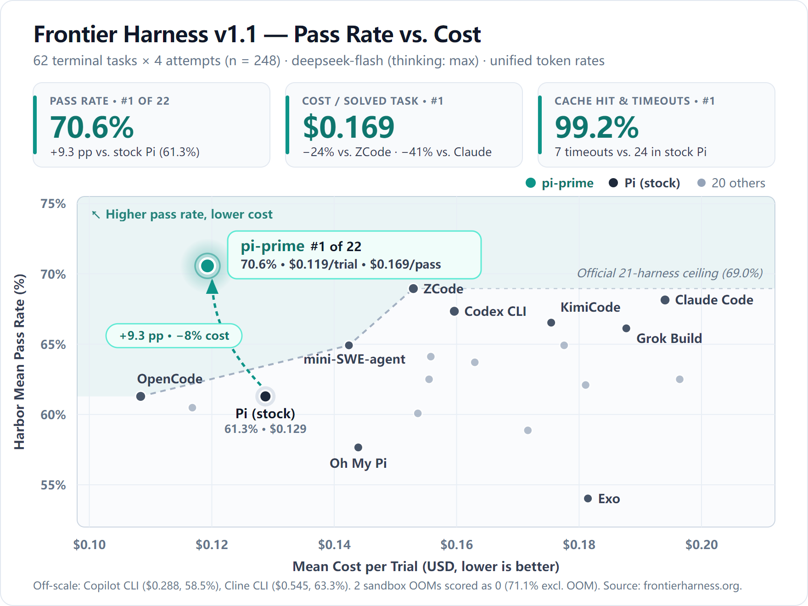

# pi-prime (π')

[English](README.md) · **简体中文**

**面向 [Pi](https://pi.dev) 的零运行时依赖核心底座增强包。**

集成了原生 Rust PTY 持久终端、无损严格文件 I/O、自适应 Code Mode、压缩后会话召回、OpenRouter/Gemini 传输层修复与 TUI 交互升级——打包为单个开箱即用的 Pi 扩展，零运行时 npm 依赖，无需配置任何外部 API Key。

---

## 基准成绩

在 **[Frontier Harness v1.1](https://frontierharness.org)**（`62` 道终端工程任务 × `4` 次独立运行 = `248` 次评估，基座模型 `deepseek-flash`，`thinking: max`）上，`pi-prime` 位于全部 21 个官方 harness 的 Pareto 前沿之上：相比原生 Pi 通过率提升 **+9.3 pp**、单次任务成本反而降低 **8%**，同时取得全榜**最低单题解决成本（`$0.169/pass`）**、**最高 Prompt Cache 命中率（`99.2%`）**，并将超时次数减少 **71%**（`24 → 7`）。

<p align="center">
  <picture>
    <source media="(prefers-color-scheme: dark)" srcset="https://raw.githubusercontent.com/l1ngzi/pi-prime/main/docs/assets/frontier-harness-dark.png">
    <source media="(prefers-color-scheme: light)" srcset="https://raw.githubusercontent.com/l1ngzi/pi-prime/main/docs/assets/frontier-harness-light.png">
    
  </picture>
</p>

| Harness | 通过率 (`n=248`) | 单次成本 | 单题解决成本 | 超时数 |
|---|---:|---:|---:|---:|
| **`pi-prime`** | **70.6%** (175/248)<sup>1</sup> | $0.119 | **$0.169** | **7** |
| ZCode *（官方第 1）* | 69.0% (171/248) | $0.153 | $0.222 | 16 |
| Claude Code *（官方第 2）* | 68.1% (169/248) | $0.194 | $0.285 | 23 |
| Codex CLI *（官方第 3）* | 67.3% (167/248) | $0.160 | $0.237 | 14 |
| Pi *（原生，官方第 14）* | 61.3% (152/248) | $0.129 | $0.210 | 24 |
| OpenCode *（官方第 15，单次最省）* | 61.3% (152/248) | **$0.108** | $0.177 | 17 |

<details>
<summary>评测口径与分项数据说明</summary>

- **评测集与模型**：`frontier-harness-eval/frontier-harness-eval@v1.1.0`（45 道 Terminal-Bench 2.1 + 17 道 Terminal-Bench 4，每题 4 次独立运行，共 248 trials）。模型为 `deepseek-flash`（`thinking: max`），且全程关闭联网与桌面工具（`web_tools: false`、`computer_use: false`）。
- **分项与缓存命中**：TB-2.1 得分 **87.2%**（`157/180`，原生 Pi 为 `77.2%`），TB-4 得分 **26.5%**（`18/68`，原生 Pi 为 `19.1%`），Prompt Cache 命中率 **99.2%**（22 家最高）。
- **统一计价**：成本全部按 Frontier Harness 公开统一费率（非命中输入 `$0.30/M`、缓存命中 `$0.007/M`、输出 `$1.20/M`）重算，与 `frontierharness.org` 21 家官方榜单快照（2026 年 11 月）同口径对比。
- **保守计分（<sup>1</sup>）**：运行中出现 2 次 Modal 沙盒 OOM，按 Harbor Mean 保守记为 `0` 分（剔除沙盒 OOM 后有效通过率为 **71.1%**，`175/246`）。
- **版本说明**：本轮评测在更名前以 `better-pi` 跑在 Pi 1.5.2 上（与 `pi-prime` 核心运行时一致）；公开榜快照中的原生 Pi 为 Pi 1.4.0。

</details>

---

## 快速安装

从 npm 安装（推荐）：

```bash
pi install npm:pi-prime
```

或固定到 GitHub Release 标签：

```bash
pi install git:github.com/l1ngzi/pi-prime@v0.1.0
```

临时试用（不写入配置）：

```bash
pi -e npm:pi-prime
```

安装时会自动下载对应平台（`win32` / `linux` / `darwin` × `x64` / `arm64`）的预编译终端辅助程序，并校验 `SHA256SUMS.txt`；仅在无匹配预编译包或下载不可用时才回退到本地锁定 Cargo 构建。

> **提示**：`pi-prime` 会自动接管 Pi 内置的 `codemode` 和 `tool-search` 扩展。如果希望消除 Pi 启动时的内置扩展替换提示，可在 `pi config` 的 **Built-in** 中关闭这两项（或在 `~/.pi/agent/settings.json` 的 `extensions` 中加入 `"-builtin:codemode", "-builtin:tool-search"`）。

---

## 核心增强

`pi-prime` 延续 Pi 的极简哲学——不塞入笨重的多 Agent 编排或黑盒流程，而是把最基础的运行时层打磨扎实，让强基座模型少受 harness 摩擦：

- **原生持久终端（`exec_command`、`write_stdin`、`terminal_sessions`、`/terminal`）** — 底层由轻量 Rust 辅助进程驱动，Windows 使用 ConPTY + Job Objects（静态 CRT，并在非 UTF-8 系统区域下自动切齐 UTF-8 控制台），Linux/macOS 使用 PTY + 进程组。支持交互式 TTY、后台常驻任务、`Ctrl+C` 中断以及跨 `/reload` 保持会话存活；单次输出默认 8,000 token 首尾预算，单会话日志最高保留 16 MiB。若缺少 helper 或 shell，会自动保留 Pi 原生终端工具不中断使用。
- **无损严格文件 I/O（`read`、`edit`、`write`）** — 原位替换原生文件工具：严格 UTF-8 校验、UTF-16/NUL 二进制拦截、拒绝模糊匹配以保留原有混合换行符与 UTF-8 BOM、Windows 保留设备名/路径安全校验，并完整兼容图片 `autoResize`。
- **自适应 Code Mode 与 Tool Search** — 自动接管内置 `codemode` 与 `tool-search`，针对 GPT 系模型自动切换为 `codemode: only`（收敛工具调用轮次），其他模型保留原生直调工具 + 可选 `codemode`；提供源码行号映射的 QuickJS 报错诊断、紧凑参数校验提示、脚本中途失败时的嵌套调用结果恢复以及精简终端卡片渲染。
- **压缩后会话召回（`session_recall`）** — 正常对话时保持隐藏不占上下文；触发 Pi 原生 compaction 后自动激活，支持对当前分支做 BM25 检索与 UTF-16 代理对安全的分页读取，并严格遵循 `context_edit` 替换结果。
- **上游协议与运行环境适配** — 向系统提示词注入 cgroup 感知的 CPU 并行度与内存上限；为 OpenRouter 上的 Claude 路由补全 Anthropic inline tools 支持及临时 `402` 额度退避重试；为 OpenRouter Gemini 路由保护工具回执文本不被上游误解析。
- **TUI 交互升级** — 增强 `/model`（`Ctrl+L`），支持根目录全局模糊搜索、后台目录刷新、收藏（`Ctrl+D`）、拖拽或 `Alt+↑`/`↓` 排序、按模型持久化 thinking level（`→` 后 `↑`/`↓`）与 `Ctrl+S` 快速设为默认（配置保存在 `~/.pi/agent/pi-prime-models.json`）；底部状态栏新增实时与最终估算输出速率（`≈ tok/s`）。

---

## 环境要求

- **Pi**：`@earendil-works/pi-coding-agent` `1.5.x`
- **Node.js**：`>=22.19.0`
- **Shell**：Windows 需要 PowerShell 7（`pwsh.exe` 在 `PATH` 中，可用 `winget install Microsoft.PowerShell` 安装）；Linux/macOS 需要 `bash`
- **Rust / Cargo**：可选，仅在从源码编译或平台无预编译产物时需要

---

## 进阶配置与本地开发

<details>
<summary>可选环境变量</summary>

| 变量 | 说明 |
|---|---|
| `PI_PRIME_ARTIFACTS_DIR` | 终端完整日志与 codemode 恢复报告的存放目录。Unix 默认 `<tmpdir>/pi-prime-artifacts-<uid>`，Windows 默认 `<tmpdir>/pi-prime-artifacts`，非活跃文件 14 天后自动清理。 |
| `PI_PRIME_TERMINAL_BIN` | 指定已有 `pi-prime-terminal` 可执行文件路径（跳过安装步骤；路径不存在时报错）。 |
| `PI_PRIME_RELEASE_BASE_URL` | 自定义二进制与 `SHA256SUMS.txt` 下载镜像（要求 HTTPS；本地测试允许 loopback HTTP）。 |
| `PI_PRIME_BUILD_FROM_SOURCE` | 安装时设为 `1`，跳过预编译下载并改用本地 Cargo 构建。 |
| `PI_PRIME_FORCE_INSTALL` | 设为 `1` 忽略已安装版本缓存强制重装。 |
| `PI_PRIME_SKIP_NATIVE_INSTALL` | 设为 `1` 跳过 `postinstall`，仅保留 Pi 原生 shell 工具。 |

</details>

<details>
<summary>pnpm / Bun 跳过安装脚本处理与本地开发</summary>

### 包管理器禁用了依赖安装脚本时
如果通过 `pnpm` 或 `bun` 安装导致 `postinstall` 被跳过，手动运行一次安装脚本即可（启动警告也会打印完整路径）：

```bash
node <package-dir>/scripts/install-native.mjs
```

### 本地开发与测试

```bash
git clone https://github.com/l1ngzi/pi-prime.git
cd pi-prime
npm install
pi install .
```

修改 TypeScript 或 Rust 后运行全套检查：

```bash
npm run check                                                   # TypeScript 类型检查
cargo test --locked --manifest-path src/terminal/native/Cargo.toml
npm test                                                        # 重新编译 bin/ 并跑完 19 组测试
```

</details>

---

## 许可与致谢

本项目基于 [Apache-2.0](LICENSE) 开源。Windows 终端实现包含衍生自 OpenAI Codex（Apache-2.0）与 WezTerm ConPTY（MIT）的代码；完整上游声明与全部锁定 Rust 依赖许可证见 [NOTICE](NOTICE) 与 [THIRD-PARTY-NOTICES.txt](THIRD-PARTY-NOTICES.txt)。
